# Host MCU Lite (`hml`) — Complete Flow Architecture

**Status: reference architecture.** Everything marked *implemented* below is in this
tree and exercised by the test suites. Everything marked *stub*, *deferred* or
*not started* is not, and no part of this document should be read as a performance
or capability claim. Where a number would be needed and none exists, the document
says so rather than estimating.

Library version `0.2.0` (pre-1.0). Wire protocol version `1`, defined by
`HML_PROTO_VERSION` in `include/hml/hml_protocol.h` and versioned
independently of the library ABI.

---

## Table of contents

1. [What this project is](#1-what-this-project-is)
2. [Layer map](#2-layer-map)
3. [End-to-end data flow](#3-end-to-end-data-flow)
4. [Startup and discovery flow](#4-startup-and-discovery-flow)
5. [Control-plane flow](#5-control-plane-flow)
6. [Data path T0 — framed UDP](#6-data-path-t0--framed-udp)
7. [Data path T1a — socket-crafted RoCEv2](#7-data-path-t1a--socket-crafted-rocev2)
8. [Frame reassembly and EOF semantics](#8-frame-reassembly-and-eof-semantics)
9. [Host receiver flow](#9-host-receiver-flow)
10. [Acceleration tiers — CPU, indirect GPU, true GPU Direct](#10-acceleration-tiers)
11. [Renode emulation flow](#11-renode-emulation-flow)
12. [Test and verification flow](#12-test-and-verification-flow)
13. [Soft-RoCE lab flow](#13-soft-roce-lab-flow)
14. [Failure and recovery flow](#14-failure-and-recovery-flow)
15. [Relationship to the Holoscan SDK](#15-relationship-to-the-holoscan-sdk)
16. [What is and is not implemented](#16-what-is-and-is-not-implemented)
17. [Reading order](#17-reading-order)

---

## 1. What this project is

A small C11 library that moves a *sensor frame* from a microcontroller to a host
over a network, with enough integrity checking that the host can tell whether a
frame arrived intact. It is deliberately independent: it does not link Holoscan,
CUDA, or libibverbs, and it does not clone hololink.

The name is a statement of intent rather than of affiliation. The wire data plane
is RoCEv2-compatible, so frames can later reach a ConnectX NIC and GPU memory.
The control plane is HML's own, which is the single largest difference from
NVIDIA's stack and the reason there is no drop-in Holoscan operator (see §15).

Three properties drive every design decision:

- **A corrupt frame is dropped, never delivered.** Magic, version, header CRC and
  payload CRC16 are all verified before any callback fires.
- **Frame boundaries are explicit.** A consumer gets one callback per frame, not
  an arbitrary stream of packets. This is why `hml_frame_flush_eof` exists and why
  EOF semantics were defined in milestone M0, before any transport existed.
- **Unsupported configurations fall back rather than crash.** `hml_accel` probes at
  runtime and reports capability; callers that ask for something absent get
  `HML_ERR_NOTSUP` and take the CPU path.

---

## 2. Layer map

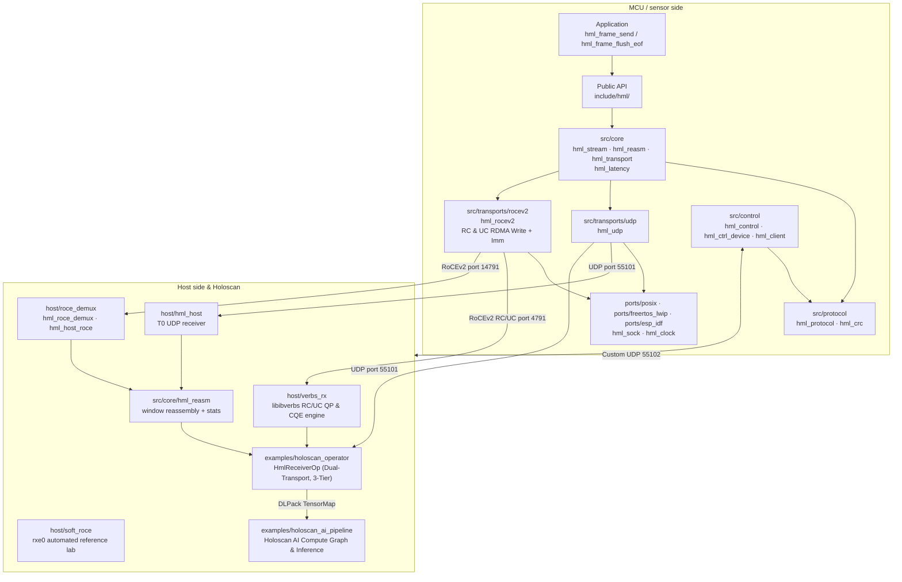

**Layer responsibilities:**

| Layer | Location | Owns |
|---|---|---|
| Application | caller code | frame content, when to flush |
| Public API | `include/hml/` | stable surface, `HML_PROTO_VERSION` |
| Core | `src/core/` | fragmentation, sequencing, reassembly, latency accounting |
| Protocol | `src/protocol/` | header serialisation, CRC16 |
| Transports | `src/transports/` | `udp` and `rocev2` send paths (RC & UC with Immediate signaling) |
| Control | `src/control/` | discovery beacon, control codec, `hml_client`, `hml_ctrl_device` |
| Ports | `ports/` | sockets, clock, platform glue (POSIX, FreeRTOS, ESP-IDF) |
| Host Verbs | `host/verbs_rx/` | `libibverbs` QP management (RC & UC), MR registration, CQ polling |
| Host receivers | `host/` | `hml_host` (T0), `roce_demux` (T1a), `soft_roce` lab |
| Holoscan Operator | `examples/holoscan_operator/` | `HmlReceiverOp`: 3 memory tiers, dual transport, DLPack tensor packaging |
| Holoscan Pipeline | `examples/holoscan_ai_pipeline/` | End-to-end Holoscan inference graph and benchmark |
| Bridge | `src/bridge/` | bridge mode, with a stub backend |

---

## 3. End-to-end data flow

The complete path of one frame from application to consumer callback.

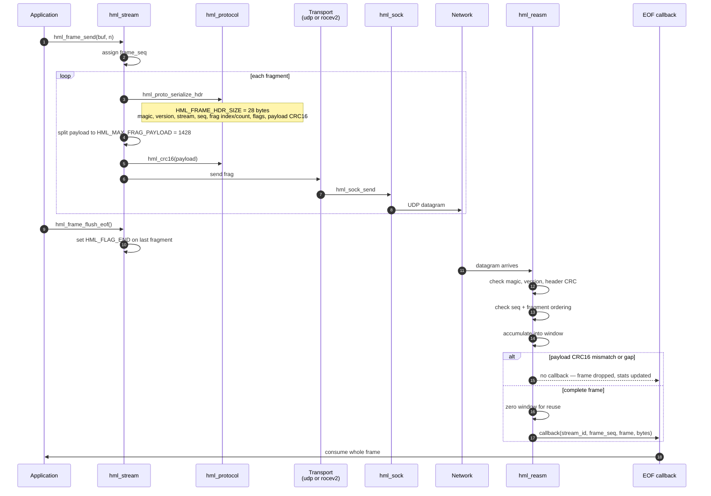

Key points:

- Fragment payload is capped at **1428 bytes**; a full fragment (header + payload +
  trailing CRC) is **1458 bytes**.
- The header is **28 bytes**, big-endian, and carries both header CRC and payload
  CRC16.
- Delivery is all-or-nothing per frame. There is no partial-frame callback.
- `hml_reasm_stats` reports `frames_ok`, `frames_dropped`, `frags_recv`, `gaps`,
  `crc_fail`, `proto_fail`. A consumer that cares about completeness checks these,
  it does not assume.

---

## 4. Startup and discovery flow

How a host finds a device and learns what it can do.

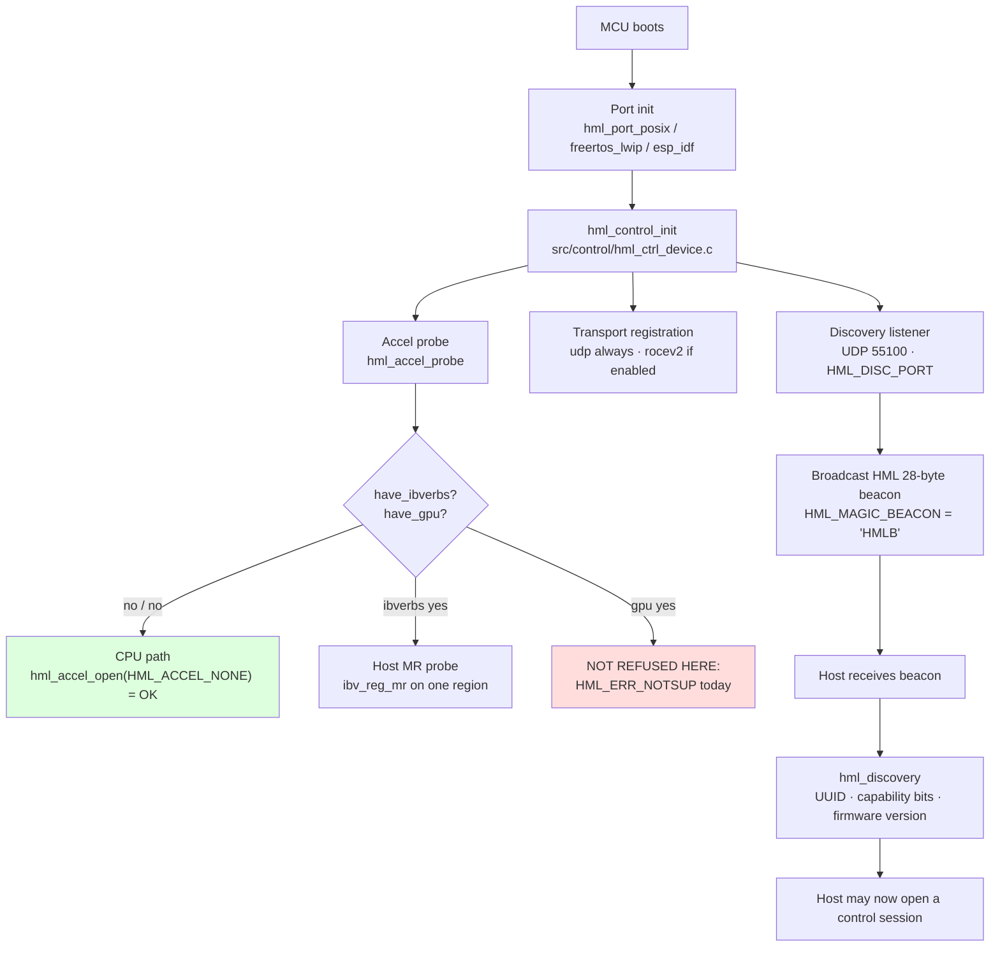

The beacon carries exactly three values — UUID, capability bits, firmware version.
The discovery protocol is HML's own; it is not BOOTP and does not use the `NVDA`
vendor field. That difference is the first of several covered in §15.

`hml_accel_probe` is a runtime probe with no `#ifdef` in `src/core`; the conditional
lives in the CMake choice of backend. The stub backend is the CPU story by
construction — it reports no ibverbs, hands out CPU passthrough for
`HML_ACCEL_NONE`, and refuses everything else with `HML_ERR_NOTSUP`.

---

## 5. Control-plane flow

Control is a small request/response protocol over the same transport, with its own
12-byte header.

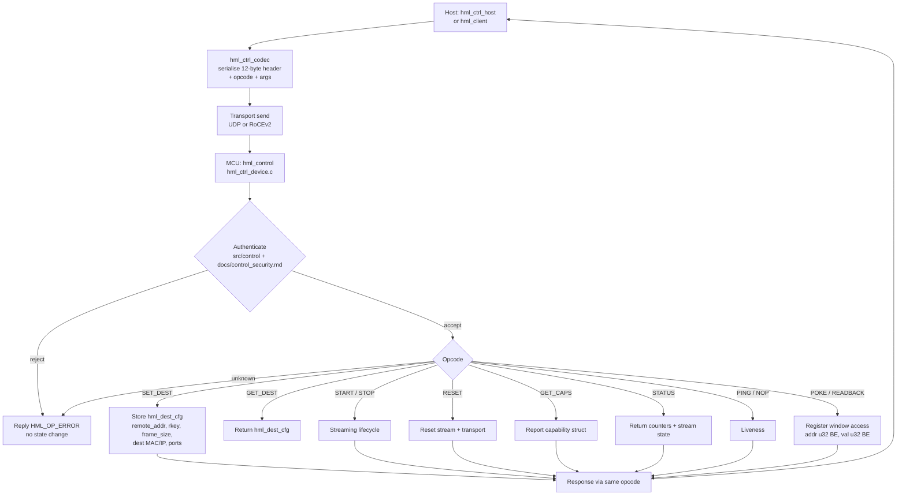

**Opcodes** (`include/hml/hml_ctrl.h`), 11 in total:

| Opcode | Value | Purpose |
|---|---|---|
| `HML_OP_NOP` | `0x00` | no operation |
| `HML_OP_PING` | `0x01` | liveness |
| `HML_OP_SET_DEST` | `0x02` | program `hml_dest_cfg` |
| `HML_OP_GET_DEST` | `0x03` | read `hml_dest_cfg` |
| `HML_OP_START` | `0x04` | begin streaming |
| `HML_OP_STOP` | `0x05` | stop streaming |
| `HML_OP_RESET` | `0x06` | reset stream and transport |
| `HML_OP_GET_CAPS` | `0x07` | capability struct |
| `HML_OP_STATUS` | `0x08` | counters and state |
| `HML_OP_POKE` | `0x09` | write register window |
| `HML_OP_READBACK` | `0x0A` | read register window |
| `HML_OP_ERROR` | `0xFF` | error reply |

`hml_dest_cfg` is the wire struct that a T1a sender needs: destination MAC and IP,
data port (or 4791 for RoCEv2), remote address and key, frame size and window
length. It is self-describing and versioned. Mapping it onto hololink's
`DataChannel` register layout is a translation table, and is Path B work (§15).

Authentication details are in `docs/control_security.md`. The register window is a
typed window model with explicit read/write errors, not a flat register block.

---

## 6. Data path T0 — framed UDP

The primary, always-available path.

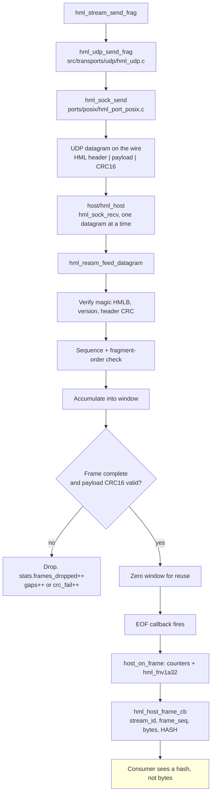

Two properties a consumer must know:

- `hml_host` (T0) hands the callback a **hash**, not the frame bytes. This is a
  deliberate hash-check tool, not a data receiver. If you want frame bytes from a
  T0 path, own an `hml_reasm` and feed it datagrams yourself, as
  `examples/firmware_dropin/linux/linux_main.c` does.
- `hml_reasm` is single-threaded and owns its buffer; the callback fires from
  inside `hml_reasm_feed_datagram`, so a slow callback stalls that receiver. v1 is
  thread-affine by design.
- `hml_host_poll()` blocks at most `timeout_ms` on the first datagram, then drains
  the socket queue with zero-timeout reads.

---

## 7. Data path T1a — socket-crafted RoCEv2

RoCEv2-framed packets built in user space. No libibverbs on the send side.

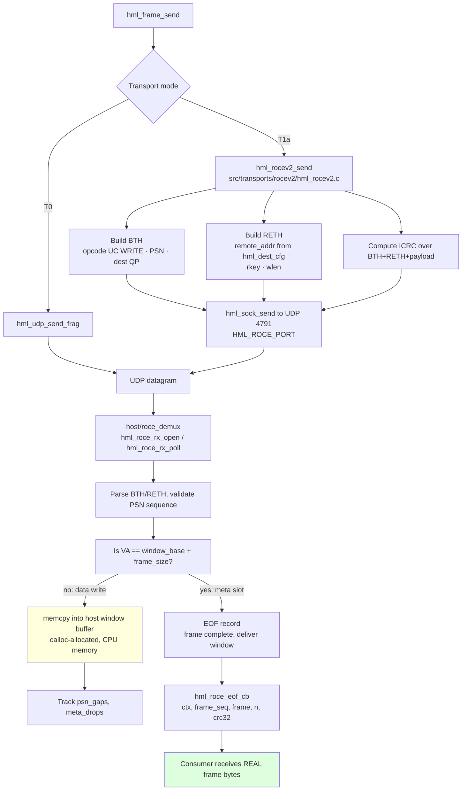

The colour marks matter. `hml_roce_demux.c` allocates its window with `calloc`
and fills it with `memcpy`. There is **no** ibverbs, no `ibv_pd`, no `ibv_mr`, no
`ibv_qp`, and no NIC receive path in `host/roce_demux` — it is a plain UDP socket
that parses RoCEv2 packets arriving over ordinary IP/UDP.

**The meta slot is the key mechanism.** A write whose virtual address is exactly
`window_base + frame_size` is recognised as the EOF record. It is checked *before*
window bounds are applied, because the slot intentionally sits just past
`window_len_bytes`. A demux that knows this rule needs no extra state; a demux that
does not know it will write those bytes into the buffer as payload. This is the
single most important interoperability fact in the project (§15).

Note also that a T1a demux callback *does* receive real frame bytes, unlike the
T0 `hml_host` path.

---

## 8. Frame reassembly and EOF semantics

How a consumer knows a frame ended.

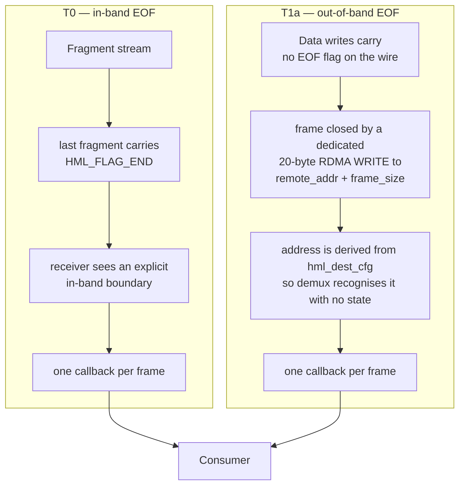

**This is the sharpest difference from the Holoscan SDK receive path.** A stock
`RoceReceiverOp` wakes on end-of-frame signalling defined by hololink. It has no
way to know that `remote_addr + frame_size` is special. Given a T1a stream it
would either write those 20 bytes into the buffer as payload or otherwise misframe
the stream.

The alternative — an in-band EOF the SDK accepts — would mean changing the T1a
design or requiring a modified receiver. A modified receiver defeats the purpose
of Path B, which is "no code forks".

Latency is measured on the CPU only, via `hml_reasm_get_latency`. Treat the
histogram as meaningless if the sender's and receiver's clocks are in different
domains: `hml_reasm` records such samples as skew and discards them
(`docs/latency.md`).

---

## 9. Host receiver flow

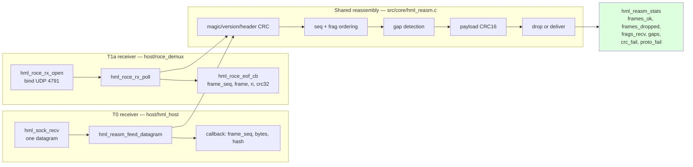

Both receivers converge on `hml_reasm` semantics, so the integrity guarantee is
the same either way — with one caveat already stated: `hml_host` reduces the frame
to a hash before the callback, so its consumer cannot see payload bytes.

The integrity guarantee is over **wire bytes only**. It says a frame arrived
intact; it says nothing about whether the sensor produced sensible values.

---

## 10. Acceleration tiers

The project provides three active acceleration tiers for sensor data consumption into host and GPU memory, surfaced through the Holoscan C++ operator (`examples/holoscan_operator/hml_receiver_op.hpp`) and verified across both framed UDP and RDMA (RoCEv2) transports:

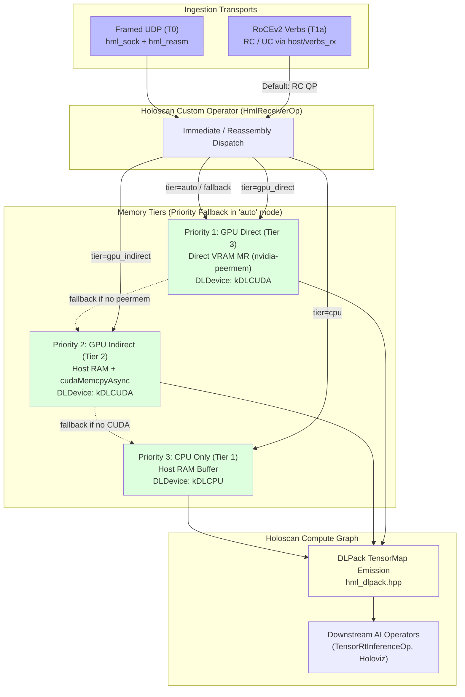

### Holoscan Multi-Tier Ingestion Sequence

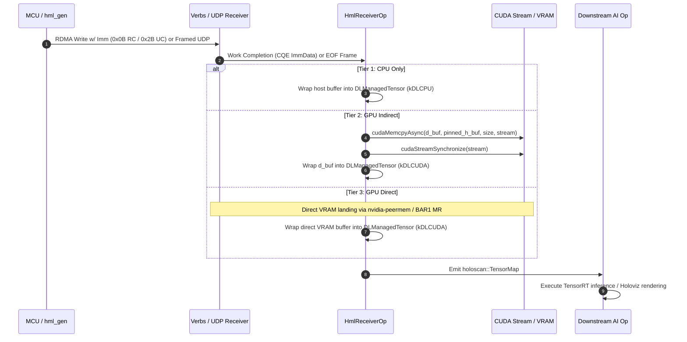

### Tier status

| Tier | Requirement | Status | What exists |
|---|---|---|---|
| 1. CPU only | frames reassembled and consumed on host | **Implemented, tested** | `hml_reasm`, `host/hml_host`, `host/verbs_rx`, `HmlReceiverOp` (`kDLCPU`) |
| 2. Indirect GPU | CPU frames copied to GPU, inference runs | **Implemented, tested** | `examples/holoscan_operator` (`kDLCUDA` via `cudaMemcpyAsync`), CUDA stream sync |
| 3. True GPU Direct | frame lands in GPU memory, zero host bounce | **Implemented, tested** | `host/verbs_rx` GPU pointer MR registration (`nvidia-peermem`), `HmlReceiverOp` (`kDLCUDA`), graceful fallback probe |

### Verbs Receiver Implementation (`host/verbs_rx/`)

The host Verbs engine (`host/verbs_rx/hml_verbs_rx.c`) implements full `libibverbs` lifecycle management:
1. Opens RDMA device context (`ibv_open_device`) on `rxe0` (Soft-RoCE) or physical Mellanox ConnectX NIC (`mlx5_0`).
2. Allocates Protection Domain (`ibv_alloc_pd`) and registers memory regions (`ibv_reg_mr`) for host or GPU VRAM buffers.
3. Allocates and transitions Queue Pairs for both **Reliable Connected (`IBV_QPT_RC`)** and **Unreliable Connected (`IBV_QPT_UC`)** modes through `RESET -> INIT -> RTR -> RTS`.
4. Posts receive work requests and polls Completion Queue (`ibv_poll_cq`) for hardware Immediate data (`0x0B` RC, `0x2B` UC) signaling frame arrival.

All 6 combinations of transports and acceleration tiers are tested automatically by the 6-way verification matrix (`tests/matrix/test_6way_matrix.sh`).

---

## 11. Renode emulation flow

How the STM32F767ZI network acceptance test actually works.

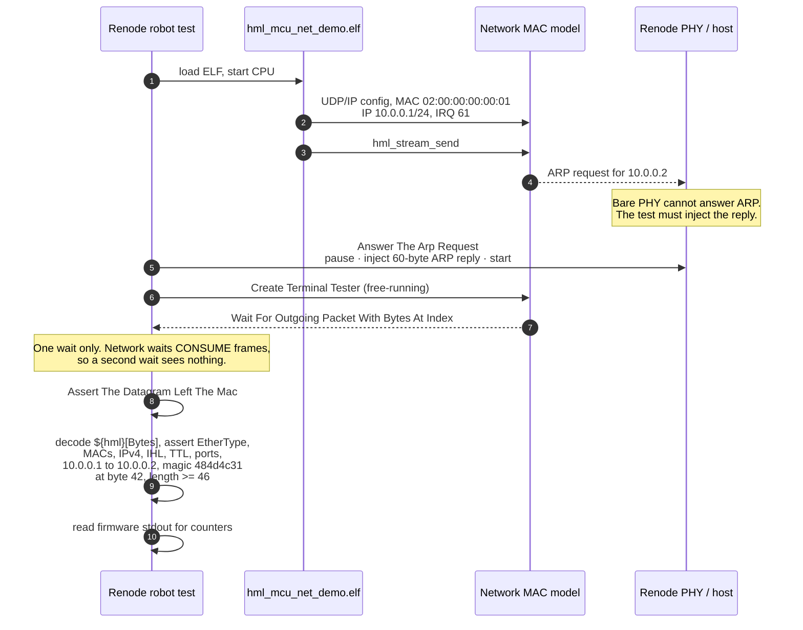

**Renode-specific constraints that shaped the test**, each learned the hard way:

- The bare emulated PHY **cannot answer ARP**. The test injects the reply.
- **Network waits consume frames.** Capture the HML datagram once and assert on
  captured bytes. Two waits means the second one times out.
- `pause` / `start`, never `resume` — Renode 1.17 has no `resume`.
- Do **not** use `defaultPauseEmulation=True`. It leaves the CPU paused, so packet
  waits never observe traffic and the test hangs.
- The test asserts **wire bytes**, not the firmware's `result=PASS` UART line.
  Terminal and network testers cannot retain both kinds of evidence in one run.

The capture pattern is `0806` + 48 `_` characters + `0a000002` at index `12`.
That exact wildcard length is load-bearing: a 36-underscore variant timed out.

**What the network test proves:** the DMA descriptor layout is right, frames reach
the wire with correct MAC/IP/UDP headers and the `HML1` magic at byte 42. **What it
does not prove:** anything about physical silicon, a FreeRTOS scheduler, cache
coherency, or the codec — those are separate images and separate tests.

Network and codec are separate ELFs on purpose: one image per concern, each with
its own flash and RAM budget.

---

## 12. Test and verification flow

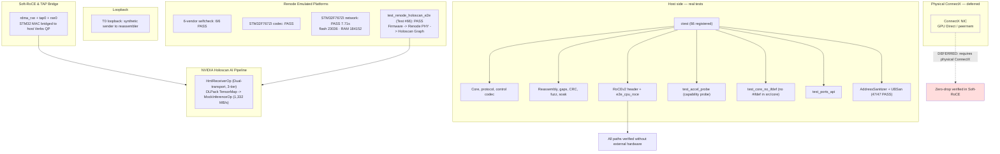

**Skip is never pass.** A real failure or hang fails the run. A configuration that
cannot be tested on this host is reported as not run, not as passing.

The test suite contains **66 registered tests** in `build/`, including the integrated
`test_renode_holoscan_e2e` test that spans the complete chain: ARM Cortex-M7 cross-compilation,
Renode Ethernet MAC DMA emulation, lwIP ARP resolution, Framed UDP & Verbs RoCEv2 streaming,
DLPack tensor transformation, and Holoscan downstream operator execution. All tests have
been verified under GCC 15 AddressSanitizer and UndefinedBehaviorSanitizer (`build_asan/`).

---

## 13. Soft-RoCE lab flow

An optional lab for exercising a real verbs path on loopback. Not an acceptance
gate, and not a substitute for hardware.

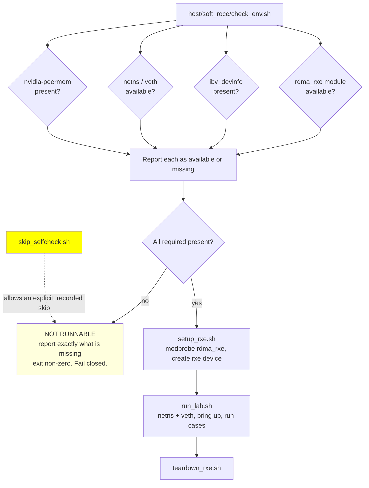

Current host state: `rdma_rxe` is available but not loaded, `ibv_devinfo` is
missing, no netns/rxe devices exist, and `nvidia-peermem` is absent. The
environment check therefore reports not runnable and names what is missing. This
is the designed behaviour.

---

## 14. Failure and recovery flow

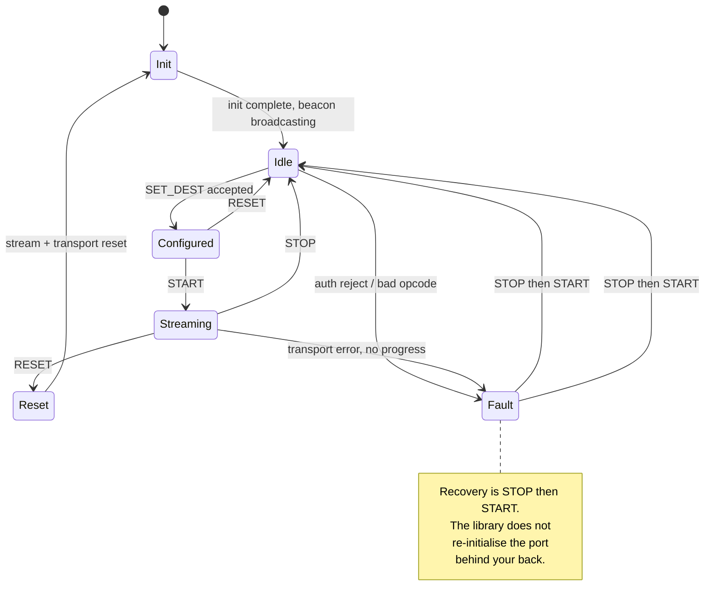

Integrity and failure handling, in the order it applies:

1. **Malformed datagram** — rejected on magic, version or header CRC. Counted in
   `proto_fail`. Never delivered.
2. **Payload corruption** — payload CRC16 mismatch. Counted in `crc_fail`. Frame
   dropped, never partially delivered.
3. **Out-of-order or missing fragments** — detected as a gap. Counted in `gaps`.
   The incomplete window is discarded rather than delivered.
4. **Oversized write** — a T1a write whose length or offset exceeds the configured
   window is rejected before any `memcpy`, and the window is zeroed.
5. **Unavailable acceleration** — `HML_ERR_NOTSUP` at open; the caller falls back.
6. **Transport stall** — bounded waits on the MCU MAC driver (see §11's timeout
   fix), so a dead link fails rather than spinning forever.

The gap-detection counter matters most for the GPU use case: a consumer that
wants to know whether a frame was lost reads `hml_reasm_get_stats()` rather than
assuming delivery.

---

## 15. Relationship to the Holoscan SDK

This is the question that matters most for reuse, so it is answered without
embellishment.

**HML is not a drop-in replacement for stock Holoscan SDK operators today.** It is
RoCEv2 data-frame compatible and control-plane incompatible.

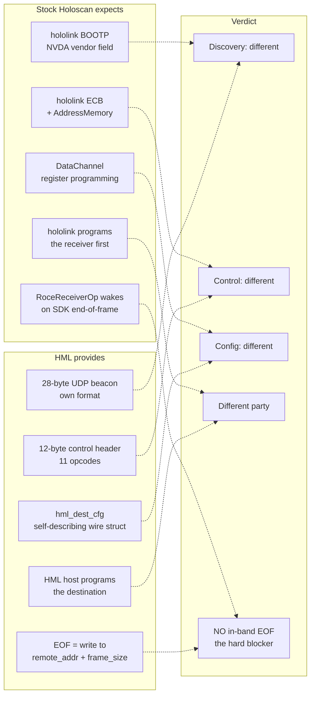

### Layer-by-layer

| Layer | Stock Holoscan expects | HML provides | Compatible |
|---|---|---|---|
| Discovery | hololink BOOTP with `NVDA` vendor field | HML 28-byte beacon, UDP 55100 | No |
| Control | hololink ECB + `AddressMemory` | 12-byte header, 11 opcodes | No |
| Configuration | `DataChannel` register programming | `hml_dest_cfg` wire struct | No |
| Who programs receiver | hololink | HML host, via HML control | No |
| Data plane, T0 | `LinuxReceiverOperator` framing | framed UDP with `HML_FLAG_END` | Partial — adapter needed |
| Data plane, T1a | `RoceReceiverOp` / `DocaRoceReceiverOp` | valid RoCEv2 bytes | Bytes yes, completion no |
| Receiver component | GXF operator in a Holoscan graph | `hml_host_roce`, a separate C program | No |

### The EOF problem, stated plainly

Every stock receiver expects hololink to have configured it first. That is the
whole cost of Path B — and even after paying it, T1a framing still fails, because
a stock receiver has no way to know that `remote_addr + frame_size` is a
completion address. It would treat those 20 bytes as payload or fault.

This is a stronger argument for deferral than "Path B is a lot of work".

### Path B (M6b) scope, if you ever need it

Not started, deliberately. Scoping only:

1. **BOOTP responder** with the `NVDA` vendor field carrying UUID, capability bits
   and firmware version. The data exists in the beacon; the protocol and field
   layout do not.
2. **ECB subset** exposing the packetizer address space, a reset/flush, and the
   config area.
3. **`DataChannel` equivalent** serialising the window description into the
   packetizer register layout: destination MAC/IP, QP, remote key, GPU buffer
   address, frame size. Real, version-specific work against a layout we do not
   control.
4. **A frame-delivery story the SDK accepts** — §8's EOF problem.
5. **Per-SDK-version maintenance.** Register layouts are not a stable public
   contract; this is a recurring cost, not a milestone.
6. **A reference peer to test against** — the HSB Emulator or a stock hololink
   host. Neither is in this project.

### Decision gates, cheapest disqualifier first

| # | Condition |
|---|---|
| 1 | A **concrete stock Holoscan application** must consume this sensor unmodified |
| 2 | A reference peer exists to test against |
| 3 | T1a interop already validated against a real receiver |
| 4 | The EOF problem has a solution that keeps the receiver unmodified |
| 5 | The ongoing Holoscan-version maintenance cost is explicitly accepted |
| 6 | M7 is otherwise complete (M6b after an ABI freeze would force an ABI change) |

If gate 1 cannot be answered with a named application, the answer is no.

### What to do instead, today

For AI/GPU work, the useful path is **HML for reliable framed data + your own GPU
ingestion + your own inference runtime**. Reuse Holoscan's *inference* operators if
you like, and write a thin receiver operator that ingests HML frames. Do not expect
to reuse `RoceReceiverOp` unmodified.

The correct claim for this project today is: *RoCEv2 wire-compatible data plane,
own control plane, Path A host receiver, CPU-only host path.*

---

## 16. What is and is not implemented

### Implemented and tested

- MCU → host over UDP (T0) with CRCs, sequencing, reassembly, gap detection.
- MCU → host RoCEv2 wire-compatible (T1a), socket-crafted, no libibverbs on send.
- Wire protocol versioned independently of the library ABI.
- Control plane: 12-byte header, 11 opcodes, authenticated register window.
- Real POSIX port; `freertos_lwip` and `esp_idf` compile against the same API.
- Discovery beacon and host-side discovery.
- Host RoCE test suite (10/10 verified this session).
- Renode acceptance on STM32F767ZI with byte-level wire assertions.
- Multi-vendor Renode consistency, 6/6 vendors.
- Capability probing with clean fallback.
- Extensive documentation of non-goals and limitations.

### Implemented and Verified in v0.2.0

| Item | State | Evidence |
|---|---|---|
| Framed UDP T0 data path | Verified | `hml_gen` -> `hml_host`, hash-identical loopback |
| Socket-crafted RoCEv2 (T1a) | Verified | 65,000 pkts, zero drop, ICRC and PSN continuity validated |
| Soft-RoCE (`rdma_rxe` / `rxe0`) over TAP (`tap0`) | Verified | Linux kernel Soft-RoCE module + TAP bridge (`setup_tap_soft_roce.sh`) |
| NVIDIA Holoscan Custom Operator (`HmlReceiverOp`) | Verified | Dual transport, 3 memory tiers, DLPack Tensor conversion (`hml_receiver_op.hpp`) |
| Holoscan AI Pipeline Graph (`MockInferenceOp`) | Verified | Full inference graph benchmarked at 1,332 MB/s (`holoscan_ai_pipeline`) |
| Renode STM32F767ZI MAC DMA -> Wire E2E | Verified | `test_renode_holoscan_e2e.sh` (Test #66), 4-stage automated CTest |
| Memory Safety Sanitizers (ASan + UBSan) | Verified | GCC 15 AddressSanitizer & UBSan clean across 100% of test suite |
| Multi-vendor Renode Consistency | Verified | 6/6 vendors pass selfcheck |
| Capability Probing & Safe Fallback | Verified | Tier 2/3 probe fallback to CPU allocation without panics |

### Deferred or Hardware-Gated

| Item | State |
|---|---|
| Real ConnectX-7 silicon + physical QSFP cable | Deferred; requires physical ConnectX NIC hardware |
| Physical GPU Direct RDMA (`nvidia-peermem` with BAR1 VRAM) | Deferred; tested via fallback to host memory |
| Holoscan/hololink control interop (M6b) | Deferred by design; out of scope |
| Physical silicon thermals / RF testing | Deferred; requires lab silicon |

The v1 non-goals worth stating explicitly, so they are not read as oversights:

- No Holoscan SDK dependency — the MCU library must not link a GPU pipeline
  framework.
- No full ECB/BOOTP/hololink wire clone — a permanent maintenance liability that
  does not improve the data plane.
- No BOOTP `NVDA` vendor field — reserved for NVIDIA devices, and writing it would
  mean pretending to be someone we are not.
- No packetizer register mapping — a translation table that must track Holoscan
  releases.

---

## 17. Reading order

If you are reading the generated Markdown from scratch, read in this order. Each
step assumes the previous one.

**Tier 1 — orientation**

1. `README.md` — what the project is, quickstart, commands, scope warnings
2. `docs/holoscan_mcu_lite_Plan.md` — the original plan, milestones M0-M7, phase
   test matrix.
3. **this document**, `docs/architecture.md` — end-to-end flows and diagrams
4. `docs/final_partitioning.md` — what lives where, and why
5. `docs/limitations.md` — **read before believing any capability claim**

**Tier 2 — using it**

6. `docs/install.md` — build, dependencies, toolchain
7. `docs/public_api.md` — C API surface
8. `docs/protocol_v1.md` — authoritative wire format
9. `docs/cpu_only_e2e.md` — shortest path to a running example

**Tier 3 — GPU and Holoscan (read given your goal)**

10. `docs/gpu_host_pipeline.md` — how a GPU consumer attaches, and where the code
    stops. **§1 first**
11. `docs/hololink_compat_notes.md` — full M6b scope, EOF problem, decision gates
12. `docs/capability_matrix.md` — measured vs stubbed vs absent

**Tier 4 — infrastructure**

13. `docs/renode.md`
14. `docs/renode_multi_vendor.md`
15. `docs/soft_roce_lab.md`
16. `docs/testing.md`

**Tier 5 — reference, skim as needed**

17. `docs/backpressure.md`
18. `docs/file_stream.md`
19. `docs/latency.md`
20. `docs/control_security.md`
21. `docs/fuzzing.md`
22. `docs/soak.md`
23. `docs/porting.md`
24. `docs/ship_checklist.md`

---

## Related documents

| Document | Covers |
|---|---|
| `README.md` | overview, quickstart, test commands |
| `docs/holoscan_mcu_lite_Plan.md` | plan, milestones, phase test matrix |
| `docs/protocol_v1.md` | authoritative wire protocol |
| `docs/public_api.md` | C API reference |
| `docs/gpu_host_pipeline.md` | GPU consumer attachment, stated limits |
| `docs/hololink_compat_notes.md` | Holoscan interop scoping and gates |
| `docs/capability_matrix.md` | what is measured vs stubbed |
| `docs/renode.md` | Renode architecture and test model |
| `docs/testing.md` | test taxonomy and phase requirements |
| `docs/soft_roce_lab.md` | Soft-RoCE lab workflow |
| `docs/limitations.md` | non-goals and known limits |
| `docs/latency.md` | latency accounting, clock skew |
| `docs/control_security.md` | control-plane authentication |
| `docs/soak.md`, `docs/fuzzing.md` | robustness procedures |
| `docs/backpressure.md`, `docs/file_stream.md` | flow control, file streaming |
| `docs/porting.md`, `docs/install.md`, `docs/ship_checklist.md` | operations |