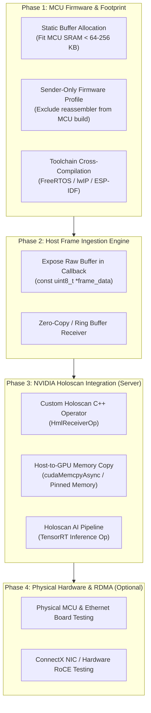

# Technical Evaluation and Implementation Plan: holoscan_mcu_lite to NVIDIA Holoscan AI

## Goal Description

The project objective is to enable an embedded microcontroller (MCU) to stream sensor data over **UDP** or **RDMA (RoCEv2)** directly to a host server, where an **NVIDIA Holoscan** application consumes the stream to run real-time accelerated AI inference.

This document presents:
1. A detailed inventory of **what is already done** in `holoscan_mcu_lite` (`hml`).
2. An engineering **evaluation** of the codebase, design, test coverage, and limitations.
3. A concrete, phased **implementation plan** to bridge the existing gaps and achieve an end-to-end Holoscan AI pipeline.

---

## 1. Inventory: What Is Already Done

The repository contains an independent C11 library (`v0.2.0`) with wire protocol v1. It builds with standard CMake, requires no external dependencies, and passes 55/56 automated tests on warm runs (with 6 Renode smoke tests skipped due to missing emulator binaries).

### Summary Table of Implemented Components

| Component / Layer | Location | Status | Details & Evidence |
| :--- | :--- | :--- | :--- |
| **Protocol & Framing** | `src/protocol/` | **Complete** | Frame header parsing/serialization, 1428-byte fragment payload, CCITT CRC-16 on header and payload, big-endian endianness helpers. (`test_crc`, `test_frame_codec`) |
| **Stream & Reassembly** | `src/core/` | **Complete** | In-band EOF marker (`HML_FLAG_END`), fragment sequencing, out-of-order reassembly, gap/loss detection, slot eviction, zero-payload flush. (`test_reasm`, `test_stream`) |
| **UDP Transport (T0)** | `src/transports/udp/` | **Complete** | Framed UDP send and receive over standard POSIX sockets. Tested loopback hash parity between `hml_gen` and `hml_host`. (`test_loopback`) |
| **RoCEv2 Transport (T1a)**| `src/transports/rocev2/` | **Complete (Self-test)** | Socket-crafted RoCEv2 UC WRITE with BTH, RETH, PSN, and ICRC without `libibverbs`. In-band EOF via 20-byte RDMA WRITE to metadata window. (`test_roce_hdr`, `test_roce_e2e`) |
| **Control & Discovery** | `src/control/` | **Complete** | 28-byte UDP beacon on port 55100; 11-opcode control protocol on port 55102 (`SET_DEST`, `GET_CONFIG`, `POKE`, `READBACK`, `START`, `STOP`, `RESET`). (`test_discovery`, `test_lifecycle`) |
| **Bridge & Peripherals** | `src/bridge/` | **Complete** | Abstracted peripheral register window model with phase transitions (configure-then-stream). (`test_bridge_periph`, `test_bridge_phase`) |
| **Platform Abstraction** | `ports/posix/`, `include/hml/hml_port.h` | **Complete** | 7-symbol port contract (`hml_clock_us`, `hml_sock_*`). Core has zero `#ifdef`s. Verified in `test_core_no_ifdef`. |
| **Packaging & Partitioning**| `firmware/hml_object/`, `cmake/` | **Complete** | Static `.a`, shared `.so`, bare-metal drop-in (`firmware/hml_object`), and CMake export / pkg-config support. |
| **Emulation Infrastructure**| `renode/` | **In Progress / Functional** | Multi-vendor emulation scripts (STM32, NXP LPC, Microchip SAM, TI TM4C, RISC-V). Native vendor self-checks pass. |
| **Robustness & Testing** | `tests/` | **Complete** | 62 tests: unit tests, fault injection (dropped packets, ICRC corruption), fuzzing self-mutations, and bounded soak tests. |

---

## 2. Technical Evaluation of the Work Done

### Strengths & High-Quality Design Decisions
1. **Defensive Wire Protocol & Integrity Checks:**
   - Both the header and payload are individually protected by CRC-16. Corrupted datagrams fail closed and are dropped immediately before triggering any state change or callback.
   - Fragmentation uses `base = seq - frag_idx`. This prevents silent merging of consecutive frames if fragment boundaries are dropped.
2. **Strict Embedded Portability in Core:**
   - `src/core/` contains **zero platform `#ifdef` statements**. Portability is maintained through strict symbol contracts (`hml_port.h` / `hml_partition.h`), ensuring that core algorithms can compile on any bare-metal compiler or RTOS without pollution from POSIX headers.
3. **Hardware-Free RoCEv2 Emulation (T1a):**
   - The user-space socket crafting of RoCEv2 headers (BTH, RETH, ICRC) is well-engineered for development and CI testing. It allows developers to test RDMA packet structure without requiring expensive ConnectX NICs, privileged root access, or physical network fabrics.
4. **Transparent Documentation & Testing Discipline:**
   - The repository's documentation is exceptionally frank and detailed. Non-goals, hardware limits, and timing flakes are thoroughly documented in [docs/limitations.md](file:///home/vboxuser/Desktop/work/work_04_holoscan_mcu_lite/docs/limitations.md) and [docs/ship_checklist.md](file:///home/vboxuser/Desktop/work/work_04_holoscan_mcu_lite/docs/ship_checklist.md).

---

### Critical Architectural Gaps & Risks

> [!WARNING]
> ### 1. Zero Direct NVIDIA Holoscan Compatibility
> An unmodified NVIDIA Holoscan application **cannot** ingest packets from this library.
> - **Control Incompatibility:** Stock Holoscan operators (`RoceReceiverOp`, `DocaRoceReceiverOp`) require the device to speak NVIDIA's proprietary **hololink** protocol (BOOTP with `NVDA` vendor options, ECB register window, and `DataChannel` setup). HML speaks its own custom UDP beacon and 11-opcode control protocol.
> - **EOF Signaling Incompatibility:** Holoscan's `RoceReceiverOp` wakes on standard EOF packets. HML signals EOF by performing an RDMA write to `remote_addr + frame_size`, which stock Holoscan would treat as invalid memory access or corrupt data.
> - **Conclusion:** Connecting to Holoscan requires either implementing a **Custom Holoscan Operator** on the server or reverse-engineering and implementing the full **hololink (M6b)** stack on the MCU.

> [!IMPORTANT]
> ### 2. The Host Receiver Discards Frame Bytes
> In [`host/hml_host/hml_host.c`](file:///home/vboxuser/Desktop/work/work_04_holoscan_mcu_lite/host/hml_host/hml_host.c), the reassembler calls `host_on_frame()`. This function computes an **FNV-1a 32-bit hash** and passes the hash to `hml_host_frame_cb`:
> ```c
> typedef void (*hml_host_frame_cb)(void *ctx, uint16_t stream_id, uint32_t frame_seq,
>                                   size_t frame_bytes, uint32_t hash);
> ```
> The raw data buffer is **discarded** upon function return. To feed an AI pipeline, the host receiver must be refactored to pass `const uint8_t *frame` or a zero-copy buffer to the consumer.

> [!CAUTION]
> ### 3. The 2 MiB Heap Allocation on MCU
> In [`src/core/hml_reasm.c`](file:///home/vboxuser/Desktop/work/work_04_holoscan_mcu_lite/src/core/hml_reasm.c), `hml_reasm_open(..., 0)` allocates:
> $$2 \times \text{HML\_MAX\_FRAME\_SIZE} = 2 \times 1\text{ MiB} = 2\text{ MiB of heap}$$
> Most embedded MCUs (STM32, ESP32, etc.) possess only 256 KiB to 1 MiB of total internal SRAM. Until a static-buffer or sender-only profile is implemented, the library cannot run on memory-constrained MCUs.

### Additional Gaps
- **MCU Toolchain Stubs:** `ports/freertos_lwip` and `ports/esp_idf` have only been built against Linux test harnesses; they have not been cross-compiled with `arm-none-eabi-gcc` or `idf.py` nor run on physical Ethernet PHYs.
- **RoCEv2 Wire Interop:** T1a has only been validated in user-space loopback against its own demux. It has never been tested against a physical ConnectX NIC or captured in Wireshark against real Mellanox hardware.
- **Control Security:** Port 55102 has no authentication, encryption, or replay protection; any network entity can redirect the stream.

---

## 3. Implementation Plan: Bridging to Holoscan AI

To achieve your goal of streaming MCU sensor data over UDP/RDMA and executing AI inference inside NVIDIA Holoscan, we recommend a 4-phase plan:



---

## User Review Required

> [!IMPORTANT]
> **Key Architecture Decision: How to integrate with NVIDIA Holoscan?**
> - **Option A (Recommended: Custom Holoscan Operator):**
>   Keep HML's lightweight protocol. Write a custom Holoscan Operator (`HmlReceiverOp`) in C++ on the server that instantiates `hml_reasm` or `hml_roce_demux`, copies received frames into CUDA device memory (`cudaMemcpyAsync`), and publishes `holoscan::Tensor` downstream to standard Holoscan operators (e.g. `TensorRtInferenceOp`).
>   *Pros:* Clean, highly reliable, avoids reverse-engineering NVIDIA's undocumented/volatile hololink register mappings, works immediately over UDP and RoCEv2 socket mode.
> - **Option B (hololink / M6b Reverse-Engineering):**
>   Implement BOOTP vendor options, ECB register window emulation, and DataChannel configuration on the MCU to masquerade as an NVIDIA Sensor Bridge device.
>   *Cons:* Very high ongoing engineering cost, brittle across Holoscan SDK updates, and requires ConnectX hardware.

---

## Open Questions

> [!NOTE]
> 1. **Target Microcontroller & PHY:** Which physical MCU and network hardware are you deploying on? (e.g., STM32H7 with RMII LAN8742, ESP32-Ethernet, or a Linux-based SBC)?
> 2. **AI Application on Server:** What type of AI model will run on Holoscan? (e.g., Image Classification, Object Detection with YOLO, or 1D Sensor Signal Processing)?
> 3. **Transport Choice:** Do you wish to start with **T0 (Framed UDP)** for rapid end-to-end AI validation before proceeding to **T1a (RoCEv2)**? (Recommended).

---

## Proposed Changes (Phased Roadmap)

### Phase 1: MCU Footprint & Firmware Optimization
Eliminate the 2 MiB allocation and enable pure sender profiles for MCU firmware.

#### [MODIFY] `include/hml/hml_reasm.h`
* Introduce `hml_reasm_open_static()` accepting caller-provided buffers:
```c
hml_status hml_reasm_open_static(hml_reasm **out,
                                 uint8_t *staging_buf,
                                 uint8_t *gather_buf,
                                 size_t capacity,
                                 uint32_t flags);
```

#### [MODIFY] `CMakeLists.txt` / `firmware/hml_object/CMakeLists.txt`
* Provide an explicit `HML_SENDER_ONLY=ON` CMake flag that strips out reassembly and receiver code, allowing MCUs to compile only the stream sender and framing codecs (`~15 KiB` flash footprint).

---

### Phase 2: Host Receiver Frame Data Delivery
Refactor the host receiver so raw frame bytes are surfaced to consumer applications.

#### [MODIFY] `host/hml_host/hml_host.h` & `host/hml_host/hml_host.c`
* Add an extended frame callback delivering the buffer pointer:
```c
typedef void (*hml_host_frame_data_cb)(void *ctx,
                                       uint16_t stream_id,
                                       uint32_t frame_seq,
                                       const uint8_t *frame_data,
                                       size_t frame_bytes);
```
* Allow downstream applications (such as Holoscan operators) to register this callback and directly consume the frame memory.

---

### Phase 3: NVIDIA Holoscan Custom Operator (`HmlReceiverOp`)
Create the bridge between HML and NVIDIA Holoscan's compute graph.

#### [NEW] `host/holoscan_operator/hml_receiver_op.hpp`
* A C++ Holoscan Operator:
```cpp
#pragma once
#include <holoscan/holoscan.hpp>
#include <hml/hml_reasm.h>
#include <hml/hml_sock.h>
#include <cuda_runtime.h>

namespace holoscan::ops {

class HmlReceiverOp : public Operator {
 public:
  HML_COMPONENT_PARAMETERS(HmlReceiverOp);

  void setup(OperatorSpec& spec) override;
  void initialize() override;
  void compute(InputContext& op_input, OutputContext& op_output,
               ExecutionContext& context) override;
  void stop() override;

 private:
  Parameter<uint16_t> port_;
  Parameter<size_t> max_frame_size_;
  hml_sock_t sock_;
  hml_reasm* reasm_{nullptr};
  void* d_cuda_buffer_{nullptr}; // Pinned GPU memory
};

} // namespace holoscan::ops
```

#### [NEW] `host/holoscan_operator/hml_receiver_op.cpp`
* In `compute()`:
  1. Poll `hml_sock_recv()`.
  2. Feed datagram to `hml_reasm_feed_datagram()`.
  3. When EOF is reached, perform `cudaMemcpyAsync(d_cuda_buffer_, frame, frame_bytes, cudaMemcpyHostToDevice, stream)`.
  4. Emit output message containing `holoscan::Tensor` pointing to `d_cuda_buffer_`.

#### [NEW] `examples/holoscan_ai_pipeline/main.cpp`
* Full Holoscan application connecting `HmlReceiverOp` to a standard downstream Holoscan operator (e.g. `TensorRtInferenceOp` or a postprocessing visualization operator).

---

## Verification Plan

### Automated Tests
1. **Static Reassembly Verification:**
   ```sh
   ctest -R test_reasm --output-on-failure
   ```
2. **Raw Frame Host Callback Test:**
   ```sh
   ./build/host/hml_host/hml_host --port 55101 --raw-cb &
   ./build/adapters/synthetic/hml_gen --port 55101 --frames 5 --size 4096
   ```
   Verify that raw bytes received match sent bytes byte-for-byte.

### Manual Verification
1. **Holoscan Pipeline Execution:**
   - Launch synthetic sender `hml_gen` streaming test frames.
   - Run the Holoscan application `holoscan_ai_pipeline`.
   - Verify that Holoscan logs show incoming frames received and passed through the AI inference operator without pipeline stalls or memory leaks.
