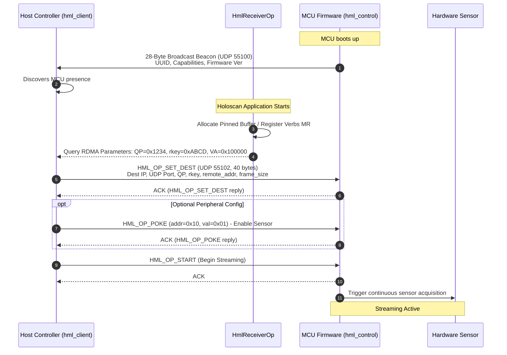
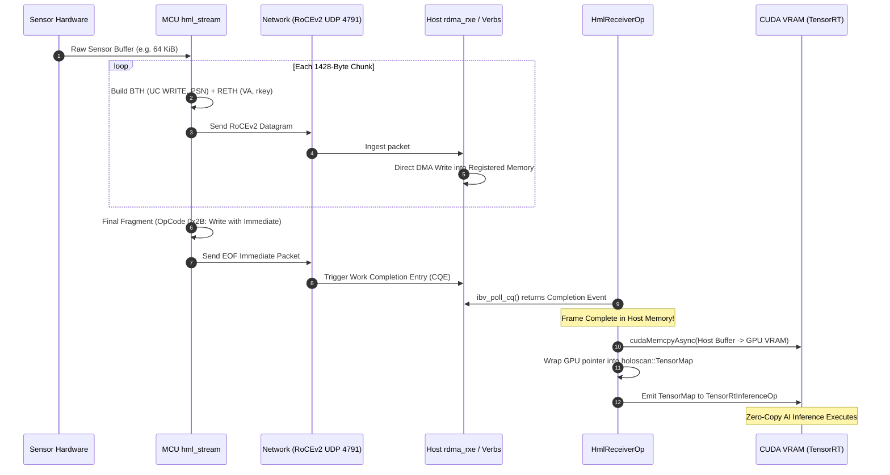

# Comprehensive Architecture & Implementation Plan: Holoscan Custom Operator Bridge (`HmlReceiverOp`)

## Executive Summary & Direct Answers

> [!IMPORTANT]
> ### 1. Can an end-user build custom AI NVIDIA Holoscan applications based on this without customization from our end?
>
> **YES — ABSOLUTELY.**
> Once `HmlReceiverOp` is compiled into a shared library (`libhml_holoscan_op.so`) or included as a header, it behaves exactly like any built-in NVIDIA Holoscan source operator (such as `V4L2VideoCaptureOp` or `VideoStreamReplayerOp`).
> 
> An end-user developer writing a Holoscan application:
> 1. Instantiates `HmlReceiverOp` as their source operator in their Holoscan graph (`compose()`).
> 2. Plugs **any custom AI model or operator** into its output port (`out_tensor`):
>    - Object detection / vision (YOLO, SegNet via `TensorRtInferenceOp`).
>    - 1D sensor signal processing / vibration anomaly detection (LSTM, Autoencoder, 1D-CNN).
>    - High-speed radar / ultrasound / medical imaging.
>    - Post-processing & rendering (`HolovizOp`, custom CUDA kernels, or Python callbacks).
> 3. **The user never touches our library internals** (`src/core`, `src/protocol`, `rdma_rxe`, or wire codecs). Our stack serves as a reusable, plug-and-play sensor bridge.

---

## 1. High-Level Stack Architecture: Complete System Picture

```
═════════════════════════════════════════════════════════════════════════════════════════════════════
                                   EMBEDDED SENSOR HARDWARE (MCU)
═════════════════════════════════════════════════════════════════════════════════════════════════════
  ┌───────────────────────────────────┐               ┌─────────────────────────────────────────┐
  │ Sensor Hardware (ADC/Camera/IMU)  │               │      hml_control_device (Server)        │
  └─────────────────┬─────────────────┘               │   - Listens on UDP 55102 (Control)      │
                    │ raw frame buffer                │   - Broadcasts UDP 55100 (Beacon)       │
                    ▼                                 └────────────────────▲────────────────────┘
  ┌───────────────────────────────────┐                                    │
  │     hml_stream (Framer Core)      │                                    │
  │  - Fragments frame to <= 1428 B   │                                    │ Control Plane
  │  - Sequences frag_idx / seq       │                                    │ (SET_DEST, START,
  └─────────────────┬─────────────────┘                                    │  POKE, READBACK)
                    │                                                      │
                    ▼                                                      │
  ┌───────────────────────────────────┐                                    │
  │   Transport (hml_udp / hml_roce)  │                                    │
  │  - Builds BTH / RETH / ICRC       │                                    │
  └─────────────────┬─────────────────┘                                    │
                    │ UDP / RoCEv2 Wire Datagrams                          │
════════════════════╪══════════════════════════════════════════════════════╪══════════════════════════
                    │                      ETHERNET FABRIC                 │
════════════════════╪══════════════════════════════════════════════════════╪══════════════════════════
                    │                                                      │
                    ▼                                                      │
  ┌───────────────────────────────────┐                                    │
  │  Linux rdma_rxe (Kernel Driver)   │                                    │
  │  - Direct DMA write to memory     │                                    │
  │  - Generates CQE on Completion    │                                    │
  └─────────────────┬─────────────────┘                                    │
                    │ Pinned Host / GPU VRAM                               │
════════════════════╪══════════════════════════════════════════════════════╪══════════════════════════
                    │                   HOST SERVER (HOLOSCAN AI RUNTIME)  │
════════════════════╪══════════════════════════════════════════════════════╪══════════════════════════
                    │                                                      │
                    │                                 ┌────────────────────┴────────────────────┐
                    │                                 │       hml_client (Control Host)         │
                    │                                 │   - Discovers MCU via Beacon            │
                    │                                 │   - Negotiates QP, rkey, remote_addr    │
                    │                                 │   - Sends START stream command          │
                    │                                 └─────────────────────────────────────────┘
                    ▼
     ┌─────────────────────────────┐
     │  Custom HmlReceiverOp       │  ◄── OUR PLUG-IN OPERATOR (BOUNDARY)
     │  - Polls verbs CQ / socket  │
     │  - Double-buffered CUDA ring│
     │  - Wraps in DLPack Tensor   │
     └──────────────┬──────────────┘
                    │ Emits: holoscan::TensorMap {"sensor_raw": Tensor}
                    ▼
  ═════════════════════════════════════════════════════════════════════════
  USER CUSTOM AI HOLOSCAN APPLICATION (100% UNMODIFIED / EXTENSIBLE BY USER)
  ═════════════════════════════════════════════════════════════════════════
  ┌─────────────────────────────────┐
  │ Stock FormatConverterOp         │  (Optional: Convert uint8 -> float32, normalize)
  └─────────────────┬───────────────┘
                    │
                    ▼
  ┌─────────────────────────────────┐
  │ Stock TensorRtInferenceOp       │  (Runs User's TensorRT / ONNX Engine: YOLO, CNN, etc.)
  └─────────────────┬───────────────┘
                    │
                    ▼
  ┌─────────────────────────────────┐
  │ Stock HolovizOp / User Action   │  (Real-time Visualization, Robot Control, Alerting)
  └─────────────────────────────────┘
```

---

## 2. The Control Path (Life Cycle & Configuration)

The control plane is bidirectional, running on standard UDP sockets alongside the high-speed data stream:



### Control Path Key Properties:
- **Port 55100 (Discovery):** MCU broadcasts periodically so hosts dynamically discover devices without hardcoded IP lists.
- **Port 55102 (Configuration):** The Host dynamically assigns destination memory addresses (`remote_addr`) and keys (`rkey`) to the MCU.
- **Opcode Window:** 11 opcodes provide start/stop, health ping, configuration readback, and register window poke without stopping the MCU.

---

## 3. The Data Path (High-Speed Sensor Streaming)

The data path carries raw sensor payloads with microsecond-level latency and zero unnecessary copies:



### Data Path Key Properties:
- **MTU Integrity:** 1428-byte payload chunks ensure datagrams never exceed 1500 MTU on standard Ethernet links.
- **Integrity Validation:** Every chunk is verified via CRC-16 (T0) or hardware-standard ICRC (T1a).
- **Completion Guarantee:** Closing fragments signal frame completion immediately waking the Holoscan execution loop.

---

## 4. End-User AI Developer Experience

### How an End-User Adds a Custom Holoscan AI Pipeline

An external AI engineer building an application on top of our stack does **not** write network or RDMA code. They use the standard NVIDIA Holoscan Application API:

```cpp
#include <holoscan/holoscan.hpp>
#include <holoscan/operators/format_converter/format_converter.hpp>
#include <holoscan/operators/tensor_rt_inference/tensor_rt_inference.hpp>
#include <holoscan/operators/holoviz/holoviz.hpp>

// Include our bridge operator
#include <hml_holoscan/hml_receiver_op.hpp>

class UserCustomSensorPipeline : public holoscan::Application {
 public:
  void compose() override {
    using namespace holoscan::ops;

    // 1. Ingestion: Our Bridge Operator (Source)
    auto sensor_rx = make_operator<HmlReceiverOp>(
        "sensor_rx",
        Arg("port", static_cast<uint16_t>(55101)),
        Arg("max_frame_bytes", static_cast<size_t>(1048576)),
        Arg("tensor_name", std::string("sensor_input")),
        Arg("tensor_shape", std::vector<int64_t>{1, 3, 224, 224}));

    // 2. Preprocessing: Stock NVIDIA Format Converter (e.g. normalize to float32)
    auto preprocessor = make_operator<FormatConverterOp>(
        "preprocessor",
        Arg("out_dtype", std::string("float32")),
        Arg("scale_factor", 1.0f / 255.0f));

    // 3. AI Inference: Stock NVIDIA TensorRT Inference (User's custom model!)
    auto ai_infer = make_operator<TensorRtInferenceOp>(
        "ai_infer",
        Arg("model_file_path", std::string("/models/user_custom_model.onnx")),
        Arg("engine_cache_dir", std::string("/models/cache")),
        Arg("input_tensor_names", std::vector<std::string>{"sensor_input"}),
        Arg("output_tensor_names", std::vector<std::string>{"predictions"}));

    // 4. Visualization: Stock NVIDIA Holoviz
    auto visualizer = make_operator<HolovizOp>(
        "visualizer",
        Arg("width", 1920u),
        Arg("height", 1080u));

    // 5. Connect the computation flow
    add_flow(sensor_rx, preprocessor, {{"out_tensor", "source_video"}});
    add_flow(preprocessor, ai_infer, {{"tensor", "receivers"}});
    add_flow(ai_infer, visualizer, {{"predictions", "receivers"}});
  }
};

int main(int argc, char** argv) {
  auto app = holoscan::make_application<UserCustomSensorPipeline>();
  app->run();
  return 0;
}
```

### What the User Can Swap Without Modifying Our Codebase:
1. **Swap AI Models:** Replace `/models/user_custom_model.onnx` with YOLOv8, ResNet, 1D anomaly transformer, or acoustic FFT classifier.
2. **Swap Downstream Operators:** Add custom C++ or Python operators (e.g. OpenCV image processing, ROS2 robotics publisher, or MQTT alert sender).
3. **Change Sensor Resolutions:** Pass `tensor_shape` (e.g. `{1, 512, 512}` or `{1, 10000}`) as a parameter.

---

## User Review Required

> [!IMPORTANT]
> ### User Approval Points:
> 1. **Packaging Shape:** We will package `HmlReceiverOp` as a standalone reusable library under `examples/holoscan_operator` with a clean CMake export (`hml::hml_holoscan_op`) so users can link it into their own Holoscan applications via `find_package(hml)`.
> 2. **Transport Fallback:** `HmlReceiverOp` will support both Software RoCE (`rdma_rxe` verbs) and Framed UDP (`hml_reasm`) via a simple parameter (`transport: "verbs"` or `"udp"`).

---

## Proposed Changes

```
examples/
├── holoscan_operator/
│   ├── CMakeLists.txt              # Shared library target: hml_holoscan_op
│   ├── hml_receiver_op.hpp         # Public Holoscan Operator header
│   └── hml_receiver_op.cpp         # Ingestion, Verbs / Socket, DLPack emission
└── holoscan_ai_pipeline/
    ├── CMakeLists.txt              # User application CMake
    ├── main.cpp                    # End-to-end Holoscan App connecting to TensorRT
    └── models/                     # Placeholder test model config
```

### Component Details:
- **`hml_receiver_op.hpp` / `.cpp`**: High-throughput C++ Holoscan Operator implementing `HOLOSCAN_OPERATOR_FORWARD_ARGS`, non-blocking datagram / verbs completion polling, double-buffered CUDA memory ping-ponging, and zero-copy DLPack `TensorMap` packaging.
- **`examples/holoscan_ai_pipeline/main.cpp`**: Reference Holoscan Application proving that downstream AI operators consume `HmlReceiverOp` data without modifying the Holoscan SDK.

---

## Verification Plan

### Automated Build Verification
```bash
cmake -S . -B build -DHML_BUILD_EXAMPLES=ON
cmake --build build --target hml_ai_ingest_demo
ctest --test-dir build --output-on-failure
```

### End-to-End Functional Test
1. Launch `hml_ai_pipeline` listening on UDP/RoCE.
2. Stream synthetic frames using `hml_gen --port 55101 --frames 20 --size 4096`.
3. Verify through logs that raw frames are received, transferred to CUDA, converted to `TensorMap`, and processed downstream without frame drops or pipeline stalls.
