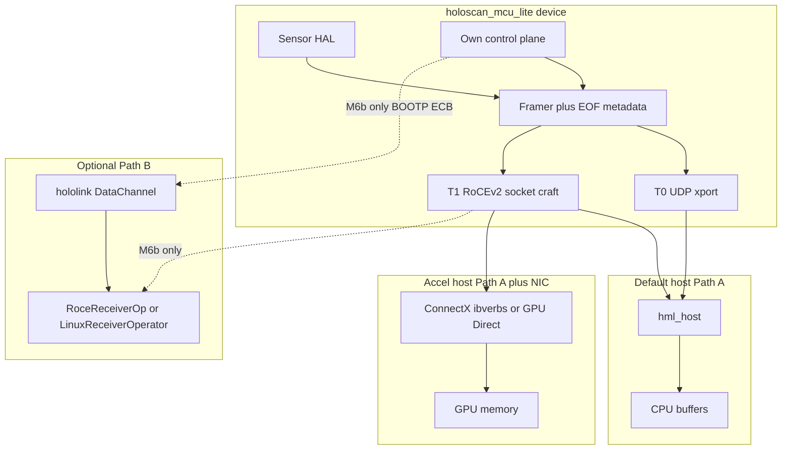

# holoscan_mcu_lite — Final Plan (rev: Emulator + SDK review)

## Decisions locked (your feedback)

- **Product:** Independent C library (not a hololink clone); **RoCEv2 data-plane wire-compatible** so ConnectX + GPU Direct can work later.
- **Sensors:** Sensor-agnostic HAL (`open` / `acquire` / `release`); adapters for camera/NFC/crypto/etc.
- **Platforms:** Core portable; vendors are ports only.
- **Transport:** **UDP first** → socket-crafted RoCEv2 → optional Soft-RoCE lab → HW RoCE + GPU Direct.
- **Modes:** Local first, then bridge.
- **Deliverable doc:** [`docs/holoscan_mcu_lite_Plan.md`](holoscan_mcu_lite_Plan.md).

## What Emulator + Holoscan SDK change in this plan

Reviewed against [HSB Emulator](https://docs.nvidia.com/holoscan/sensor-bridge/latest/emulation.html), [holoscan-sensor-bridge](https://github.com/nvidia-holoscan/holoscan-sensor-bridge), and Holoscan SDK receive docs.

### Adopt from Emulator (keep)

| Emulator fact | Plan impact |
| --- | --- |
| Sensor-agnostic; sensors via `I2CPeripheral` / app loop | Confirms generic HAL; no sensor baked into core |
| `DataPlane::send(DLTensor, FrameMetadata*)` sync send | Shape `hml_send` similarly: buffer + optional EOF/metadata flush |
| `RoCEv2Transmitter` = **Linux sockets** crafting RoCEv2 UDP | **Primary T1 path** = socket emit, *not* Soft-RoCE |
| `BaseTransmitter` / `DataPlane` pluggable transports | Keep `hml_xport_ops` vtable (udp / rocev2 / later) |
| Emulator-only build; Linux + STM32 HAL ports | Same ports strategy: POSIX reference + MCU port |
| STM32 today = **control plane only** | MCU dataplane is stretch; control-first on MCU is validated by NVIDIA |
| Loopback / netns testing | Prefer namespace loopback before dual-machine Soft-RoCE |

### Adopt from Holoscan SDK host path

| SDK fact | Plan impact |
| --- | --- |
| `RoceReceiverOp` wakes on **end-of-frame** UDP; data already in GPU via ConnectX | Framing **must** define EOF/metadata packet semantics early (M0/M1) |
| No ConnectX → `LinuxReceiverOperator` (CPU UDP → GPU copy) | Our T0/T1 host path mirrors this CPU fallback |
| `DataChannel` programs packetizer: dest MAC/IP, QP, R_Key, GPU addr, frame size | Bridge/local control must expose **dest + RDMA window** config before T2 |
| Pipeline is Holoscan operators; hololink ≠ SDK | v1 ships `hml_host`; optional later Holoscan operator or hololink-compat shim |
| `DocaRoceReceiverOp` / GPU-resident path needs hololink `DataChannel` | GPU Direct via stock Holoscan ops implies **M6b control interop**, not just RoCE bytes |

### Critical correction vs earlier draft

- **Soft-RoCE (`rdma_rxe`) is not how HSB Emulator or Holoscan Linux receive work.** Emulator crafts RoCEv2 over sockets; Holoscan uses `RoceReceiverOp` (ConnectX) or `LinuxReceiverOperator` (kernel UDP).
- Soft-RoCE remains a **secondary lab** for ibverbs CQ/MR correctness (M3b), not the main T1 acceptance gate.
- **RoCEv2 packets alone do not unlock stock `RoceReceiverOp`.** That operator expects hololink to configure the bridge via BOOTP + ECB + `DataChannel`. User chose independent library (1A) → default host is `hml_host`. Optional **M6b** adds Emulator/hololink-compatible control if you later want unmodified Holoscan apps.



## Architecture (updated)

**Three planes**

| Plane | v1 (independent) | Optional M6b (Holoscan stock apps) |
| --- | --- | --- |
| Discovery | Own UDP beacon (UUID, caps, FW) | NVIDIA BOOTP + NVDA vendor field |
| Control | Own req/resp UDP; dest IP/port/QP/R_Key/window | ECB + AddressMemory / packetizer regs |
| Data | T0 framed UDP; T1 RoCEv2 UC WRITE + EOF metadata | Same RoCEv2 shape hololink expects |

**Tiers (revised)**

- **T0:** Framed UDP + EOF → `hml_host` CPU (all platforms)
- **T1a:** Socket-crafted RoCEv2 + EOF → `hml_host` (or LinuxReceiver-like) — **primary T1**
- **T1b:** Soft-RoCE verbs lab — **optional**, correctness only
- **T2:** Real RoCE NIC + optional GPU Direct / peermem; always keep CPU fallback

## Library layout (target)

```text
holoscan_mcu_lite/
  include/hml/
  src/core/              # buffers, streams, stats, send+EOF
  src/protocol/          # discovery, control, frame + FrameMetadata
  src/transports/
    udp/
    rocev2/              # socket craft (Emulator RoCEv2Transmitter model)
  ports/                 # posix/, freertos_lwip/, esp_idf/, ...
  adapters/              # synthetic/, examples only
  host/
    hml_host/            # Path A receiver
    soft_roce/           # M3b scripts only
    hololink_compat/     # M6b optional
  tests/ examples/ docs/
  refs/                  # notes linking Emulator + NXP RT1180 demos
```

API inspiration (not a clone): Emulator `send(tensor, frame_metadata)` → `hml_frame_send` / `hml_frame_flush_eof`.

## Test strategy (applies to all milestones)

- **Harnesses:** unit (CTest/Unity), protocol fuzz, loopback (same host), netns dual-stack, dual-machine LAN, Soft-RoCE lab (M3b only), HW NIC (M6).
- **Fault injection:** loss, reorder, duplicate, truncate, corrupt CRC/ICRC, MTU shrink, control timeout, dest misconfig.
- **Metrics always logged:** pps, Mbps, frame_ok, frame_gap, pkt_loss_%, p50/p99 latency (tx enqueue → EOF rx), CPU%, drop policy hits.
- **Golden artifacts:** pcap samples per tier; bit-exact frame hashes for synthetic patterns.
- **CI bar:** M0–M2 must pass on x86_64 + aarch64 loopback without hardware.

## Milestones + phase tests

### M0 — Contracts and skeleton
- Build: wire protocol (version, stream_id, seq, ts, fragment, **EOF/metadata**, CRC); RDMA window fields documented; CMake; synthetic sensor; POSIX UDP loopback.
- **Exit:** synthetic frames + EOF over UDP; unit tests green on x86/aarch64.

**How to test M0**
- Setup: two processes on localhost (`hml_gen` → `hml_host`), fixed MTU 1500.
- Cases:
  - Encode/decode round-trip for header fields (endian, wrap of seq).
  - Single-packet frame + multi-fragment frame + EOF-only flush.
  - Reject unknown version / truncated header (must fail closed).
  - Cross-compile smoke: x86_64 and aarch64 (QEMU or CI runner).
- Pass: 100% unit tests; 1k frames loopback with hash match; zero false EOF.

### M1 — T0 data plane
- Build: framing, reassembly, gap counters; synthetic + adapter template; `hml_host` wakes on EOF.
- **Exit:** sustained T0 stream; loss documented under load.

**How to test M1**
- Setup: loopback then two hosts on 1GbE; synthetic ramp 1→N Mbps.
- Cases:
  - Happy path: N-second stream, frame hashes match, EOF count == frame count.
  - Induced 0.1% / 1% / 5% loss: gap counters increment; no hang; next good frame recovers.
  - Reorder within window: reassembly correct or documented drop.
  - Backpressure: slow consumer → drop-oldest or stop-stream (policy asserted).
  - Soak: 1h continuous; memory flat (no leak); CPU under budget for class.
- Pass: 1h soak with loss_pct ≤ injected; p99 EOF latency within written budget; no crash.

### M2 — Discovery + control (local mode)
- Build: beacon; start/stop, set dest, caps, reg poke; local mode.
- **Exit:** discover → configure dest → start/stop without rebuild.

**How to test M2**
- Setup: device silent until beacon; host enumerator with timeout.
- Cases:
  - Beacon cadence ~1 Hz; UUID/caps stable; host finds within timeout.
  - Control RTT: write dest → readback matches; idempotent start/start.
  - Stop mid-stream: EOF for in-flight frame or clean abort (documented); no further data.
  - Bad opcode / bad length: NAK + no state corruption.
  - Control under data load: control still responds within timeout while T0 streams.
  - Replay/old seq: rejected or idempotent (threat-model choice asserted).
- Pass: scripted `discover → set_dest → start → N frames → stop` green 50/50 runs; control timeout < agreed ms.

### M3 — RoCEv2 socket emit (T1a)
- Build: Emulator-style BTH/RETH/PSN/ICRC over UDP/4791; `hml_host` RoCE demux; fallback to T0.
- **Exit:** valid ICRC/PSN frames on CPU host; Soft-RoCE not required.

**How to test M3**
- Setup: netns or dual host; capture with tcpdump/Wireshark RoCE dissector; compare header layout to Emulator pcap golden if available.
- Cases:
  - Single WRITE + ICRC ok; PSN monotonic; rkey/remote_addr match control config.
  - Multi-MTU frame segmentation; EOF/metadata wakes host exactly once per frame.
  - Corrupt ICRC → drop, counter++; stream continues.
  - PSN gap → detect, optional resync policy.
  - Fallback: force RoCE bind fail → auto T0; host still completes frames.
  - Port 4791 / UDP checksum / VLAN optional tags do not break demux.
- Pass: 10k frames zero ICRC error on clean LAN; injected ICRC errors all counted; fallback path CT green.

### M3b — Soft-RoCE lab (optional)
- Build: `rdma_rxe` scripts; UC QP CQ completions.
- **Exit:** lab note only; no production perf claims.

**How to test M3b**
- Setup: two netns with `rdma_rxe` on veth; `ibv_devinfo` shows rxe.
- Cases: QP setup/teardown; MR register; CQ sees WRITE completions; mismatch GID/IP fails clearly.
- Pass: script exits 0; document “not a perf proxy for ConnectX.” Fail closed if rxe unavailable (skip, not fail CI).

### M4 — Bridge mode
- Build: remote I2C/GPIO/UART-shaped windows; host configure-then-stream; Emulator-like peripheral callbacks.
- **Exit:** stub peripheral configured over control; frames received.

**How to test M4**
- Setup: stub `I2C` memory map on device; host runs HSB-like lifecycle.
- Cases:
  - Phase order: init → GPIO reset poke → I2C reg writes → set packetizer dest → start stream.
  - I2C NAK / timeout: host gets error; no silent success.
  - Mid-stream exposure-style poke does not tear dataplane (or documented pause).
  - Concurrent: two control clients → serialize or reject second.
  - Compare sequence diagram to local HSB docs (init/config/stream).
- Pass: lifecycle script green; stub reg dump matches expected; T0/T1a frames after start.

### M5 — Platform ports
- Build: posix + Linux SBC + RTOS/lwIP (STM control-first OK); capability matrix.
- **Exit:** same API on ≥2 OS classes.

**How to test M5**
- Setup: identical example app sources; only port CMake differs.
- Cases:
  - API compile/link on each port; synthetic T0 on each.
  - Measure max stable Mbps / loss at that rate; fill capability matrix row.
  - MCU: control-only smoke if dataplane N/A (match Emulator STM32 reality).
  - DMA/cache: buffer reuse after send without corruption (pattern test).
  - Clock skew: timestamps monotonic per device.
- Pass: matrix published; each port meets its own row’s budget; no `#ifdef` in `src/core`.

### M6 — Host accelerate (T2 prep)
- Build: ConnectX/ibverbs when present; GPU Direct feature flag; CPU fallback.
- **Exit:** report or “T2 deferred”; clean fallback.

**How to test M6**
- Setup: host with RoCE NIC + optional NVIDIA GPU + `nvidia-peermem`; control run without NIC.
- Cases:
  - CPU path (no NIC): same as M3 receive.
  - Host MR + ibverbs CQ: frames land in pinned host memory; hash ok.
  - GPU path (if peermem): CUDA kernel reads buffer; no host bounce (verify with profiler/counters).
  - Missing peermem/GPU: feature off, fallback automatic, no crash.
  - Cable pull / QP error: recover or clean stop; restart works.
  - Compare CPU% vs T0 for same Mbps.
- Pass: three-way matrix (CPU / host-MR / GPU) documented; unsupported configs fall back in <1s.

### M6b — Optional hololink/Emulator interop
- Build: BOOTP vendor + ECB subset for `DataChannel` + `RoceReceiverOp`.
- **Default: deferred.**

**How to test M6b**
- Setup: stock hololink enumerator + `LinuxReceiverOperator` or `RoceReceiverOp`; or HSB Emulator as reference peer.
- Cases: BOOTP accepted; ECB R/W packetizer regs; DataChannel programs dest; one full frame into Holoscan app.
- Pass: Emulator or hololink example runs without code forks. Fail → keep Path A only.

### M7 — Harden
- Build: docs, versioning, examples, kill checklist; tag `0.1.0`.
- **Exit:** 24–72h T0 soak; non-goals documented.

**How to test M7**
- Setup: release candidate build; fuzz control + header parsers; ASAN/UBSAN where portable.
- Cases: 72h T0 soak; 24h T1a if available; fuzz 1M+ malformed packets no crash; ABI symbol freeze check; porting guide dry-run by second engineer checklist.
- Pass: soak green; fuzz no crash; docs match tree; version tags protocol + library independently.

## Phase test matrix (summary)

| Phase | Loopback | Netns/dual host | Soft-RoCE | HW RoCE NIC | GPU Direct | Holoscan stock |
| --- | --- | --- | --- | --- | --- | --- |
| M0 | Required | — | — | — | — | — |
| M1 | Required | Required | — | — | — | — |
| M2 | Required | Required | — | — | — | — |
| M3 | Required | Required | Optional compare | — | — | — |
| M3b | — | Optional | Required for M3b | — | — | — |
| M4 | Required | Required | — | — | — | — |
| M5 | Per-port | Per-port | If port claims T1 | — | — | — |
| M6 | Fallback | Required | Lab only | Required if claiming T2 | If available | — |
| M6b | — | Required | — | Preferred | Preferred | Required |
| M7 | Required | Required | Skip OK | Soak if present | Soak if present | If M6b done |

## Kill criteria

- Cannot sustain target pps on **T0** → stop T1/T2 for that device class.
- T1a socket RoCE works but Soft-RoCE diverges → keep M3b lab-only (expected).
- Want Holoscan stock ops but refuse M6b control work → **cannot** claim `RoceReceiverOp` drop-in; stay on `hml_host`.
- Bridge unused after M4 → demote bridge.
- No GPU/NIC → ship T0+T1a; T2 optional.

## v1 non-goals

- Full ECB/BOOTP/hololink wire clone (unless M6b explicitly started).
- Linking Holoscan SDK into the MCU library.
- AI on device; FPGA MIPI line-rate on ESP/STM; safety cert; PTP grandmaster.

## After approval

1. Write [`docs/holoscan_mcu_lite_Plan.md`](holoscan_mcu_lite_Plan.md) including this Emulator/SDK appendix.
2. Do not start code until you ask to execute M0.

## Multi-model + prior-art notes

Multi-model consensus (UDP-first, tiers, local-before-bridge) retained. Emulator/SDK review **reordered T1**: socket-crafted RoCEv2 primary; Soft-RoCE secondary. Prior art: NVIDIA HSB Emulator (Linux+STM32), NXP RT1180 HSB demos, Holoscan `RoceReceiverOp` / `LinuxReceiverOperator` / `DocaRoceReceiverOp`.

---

## Implementation status (2026-09-28)

This is the only section of this document that was added after the plan was
approved; everything above it is the approved plan, preserved verbatim. Two
mechanical edits were needed to keep the document usable in place: the
`docs/holoscan_mcu_lite_Plan.md` self-link now resolves to this file, and the
plan's internal links point at the sibling documents listed below.

The `todos` frontmatter above is the approved-plan record. **This table
supersedes those statuses** — do not read `status: pending` as current state.

### Milestone status

| Milestone | Status | What exists | What is *not* claimed |
| --- | --- | --- | --- |
| M0 — contracts and skeleton | **Done, tested** | 28-byte frame header, EOF/metadata model, `hml_dest_cfg` (40 B), CRC-16 + CRC-32, CMake, synthetic adapter, POSIX UDP loopback. Tests: `test_crc`, `test_frame_codec`, `test_loopback`, `test_reasm`, `test_stream`. | — |
| M1 — T0 data plane | **Done, tested** | Framing, reassembly with 2 frame windows, gap/drop/CRC counters, `hml_host` CPU receiver that wakes on EOF, adapter template. Same five tests as M0 plus `test_loopback`. | The 1 h soak, the 0.1/1/5 % loss ramps and the multi-host 1 GbE run from the M1 plan are **not** done; loss behaviour is only covered by unit-level fault injection. |
| M2 — discovery + control | **Done, tested** | 28-byte beacon broadcast, 12-byte-header control plane, all 11 opcodes, 512 B max payload, `discover → set_dest → start → N frames → stop` scripted end to end. Tests: `test_ctrl_codec`, `test_discovery`, `test_lifecycle`. | The 50/50-run stability loop and a measured control RTT budget are not recorded. `hml_beacon_parse` intentionally does not check `version`; `hml_client_discover` does. |
| M3 — RoCEv2 socket emit (T1a) | **Done, tested** | Socket-crafted IP/UDP/BTH/RETH/ICRC (no libibverbs, no ConnectX), PSN counter, 20-byte EOF metadata record, `hml_host_roce` demux, automatic T0 fallback. Tests: `test_icrc`, `test_roce_hdr`, `test_roce_e2e`. | **No NIC capture.** Every ICRC/PSN/VA claim is a golden-vector or loopback assertion on our own encoder+decoder, which agree with each other by construction. There is no independent ConnectX or hololink peer that has ever accepted these bytes. |
| M3b — Soft-RoCE lab | **Scripts and docs only** | `host/soft_roce/` setup/verify/teardown scripts and a lab note. Default CI runs `roce_lab_skip_path`, which asserts the lab is correctly gated off. | The lab itself has **never been executed** — no `rdma_rxe`/RDMA-capable host was available. Fail-closed skip by design, so this is a skip and not a failure. No verbs CQ/MR correctness claim. |
| M4 — bridge mode | **Done, tested** | Remote peripheral windows (I2C/GPIO/UART-shaped), Emulator-like peripheral callbacks, configure-then-stream, lifecycle state machine. Tests: `test_bridge_lifecycle`, `test_bridge_periph`, `test_bridge_phase`. | Only a stub peripheral is modelled. Two concurrent control clients serialize, they are not rejected — a deliberate choice recorded in the source. |
| M5 — platform ports | **Stub ports build; unmeasured** | POSIX port is real. `ports/freertos_lwip/` and `ports/esp_idf/` compile against the same API as default stubs unless `HML_PORT_HAVE_FREERTOS_LWIP` / `HML_PORT_HAVE_ESP_IDF` is defined; that is how they are built and tested here. Tests: `test_accel_probe`, `test_core_no_ifdef`, `test_ports_api`. | **No performance, throughput, loss or power number exists for any port.** No aarch64 or SBC run happened. `test_core_no_ifdef` proves `src/core` has no `#ifdef`, which is the M5 structural pass criterion, not a hardware one. No capability-matrix row is filled with measured data — see [capability_matrix.md](capability_matrix.md). |
| M6 — host accelerate (T2 prep) | **Capability probe only; T2 deferred** | `src/accel/hml_accel.c` probes at runtime for a RoCE NIC / GPU Direct and reports a capability struct; the ibverbs path is a stub. Tests: `test_accel_probe`. | **No RoCE NIC and no NVIDIA GPU were present.** No ConnectX, no `nvidia-peermem`, no ibverbs CQ/MR, no GPU-resident read, no CPU% comparison against T0. T2 stays deferred. |
| M6b — hololink / Emulator control interop | **Not started** | Nothing. Scope is written up in [hololink_compat_notes.md](hololink_compat_notes.md) so the decision is on record before any code. | No BOOTP, no ECB, no `DataChannel` register programming. Do not claim `RoceReceiverOp` drop-in compatibility. |
| M7 — harden | **Not started** | The documents in this pass are M7 doc *inputs*, not M7 completion. | No 24–72 h T0 soak, no 1M-packet fuzz, no ASAN/UBSAN run, no ABI symbol freeze. `0.1.0` is a preview version and the `hml_*` ABI is **not frozen**. |

### Test tally as of this date

`ctest --output-on-failure` in an out-of-tree build: **18 / 18 passed**. Test
names, what each one asserts and the exact commands are in [testing.md](testing.md).

```
roce_lab_skip_path  test_crc  test_frame_codec  test_loopback  test_reasm
test_stream  test_ctrl_codec  test_discovery  test_lifecycle  test_icrc
test_roce_e2e  test_roce_hdr  test_bridge_lifecycle  test_bridge_periph
test_bridge_phase  test_accel_probe  test_core_no_ifdef  test_ports_api
```

The opt-in `roce_lab` test is registered but excluded from the default 18
because M3b is unexecuted; enabling it without RDMA hardware is expected to
skip, not to pass.

### Honest summary

Everything testable without hardware is built and green, and the M0–M4 core is
the part of this plan that is genuinely finished. The three places where the
plan and the tree diverge, and the reason each is recorded as it is:

1. **T1a is self-consistent, not interoperable.** The RoCEv2 bytes are pinned by
   golden vectors and round-trip through our own demux, but the two
   T1a-specific choices (UC `0x2A` opcode instead of RC `0x0A`, and the
   little-endian 20-byte meta record instead of a 16-byte trailer) are unproven
   against any real receiver.
2. **M5 is structural only.** The RTOS ports are API-complete stubs. A green
   `test_ports_api` says the surface exists, not that it runs.
3. **T2 is deferred, not started.** The capability probe is honest about this:
   it reports what it found, which on every machine so far has been "no NIC".

### Documents in this pass

| Document | Contents |
| --- | --- |
| [protocol_v1.md](protocol_v1.md) | Normative byte-level wire spec for all four record types, with the golden vectors and the rejected-on-parse tables. |
| [testing.md](testing.md) | Build, the 18-test inventory, real CLI reference, worked T0/T1a examples, fault-injection map, metrics, and the hardware each unrun test needs. |
| [hololink_compat_notes.md](hololink_compat_notes.md) | M6b / Path-B scoping and the decision gate, written before any code so the choice is deliberate. |
| [capability_matrix.md](capability_matrix.md) | Per-port capability rows. Not authored by this pass. |
| [soft_roce_lab.md](soft_roce_lab.md) | M3b lab note. Not authored by this pass. |
| [../refs/prior_art.md](../refs/prior_art.md) | What was taken from, and deliberately not taken from, each prior-art project. |
| [../README.md](../README.md) | Project front door, under 120 lines. |
